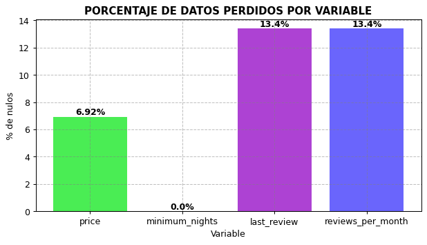
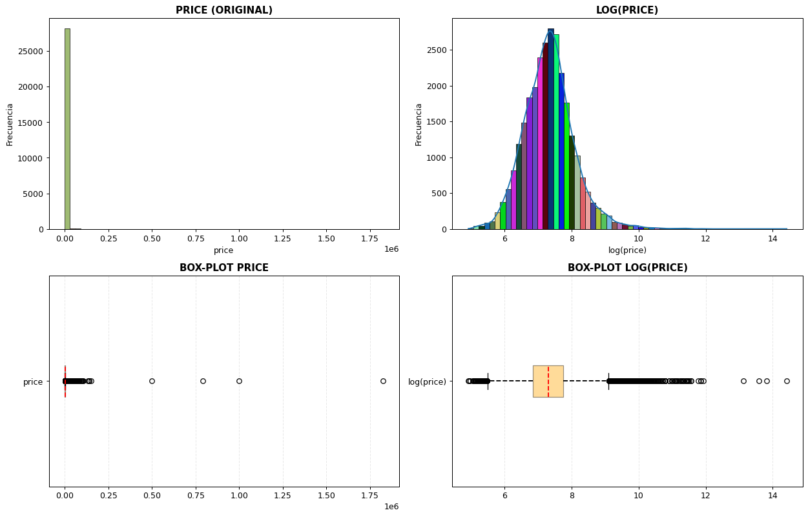
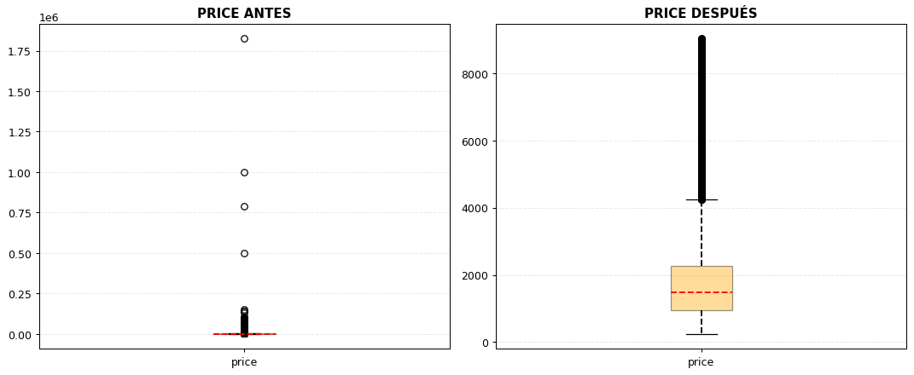
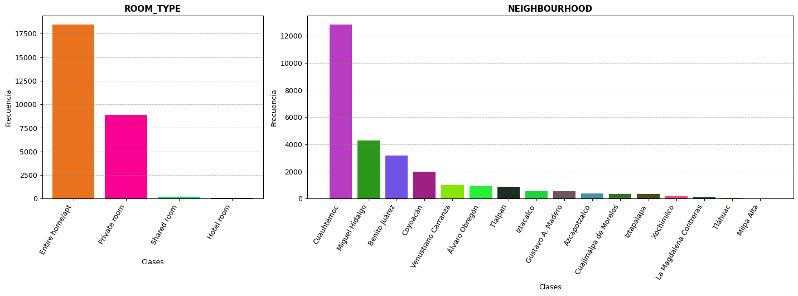
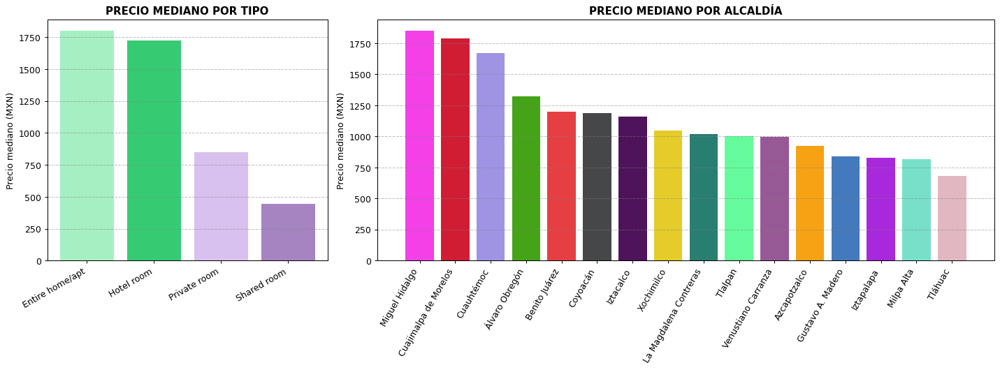
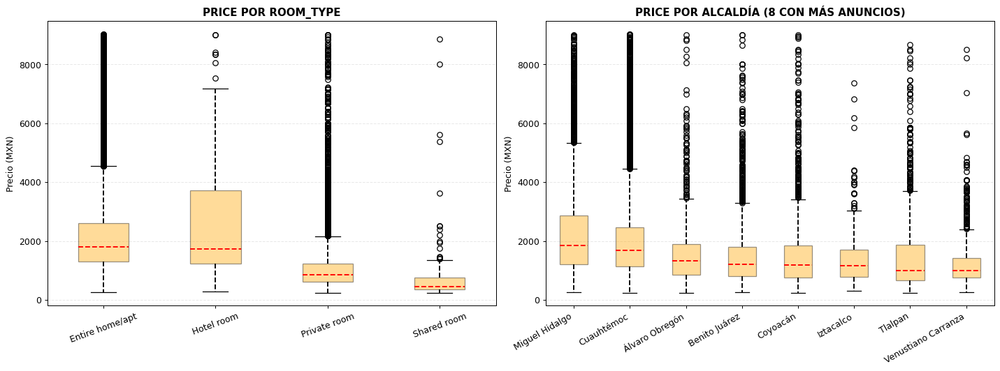
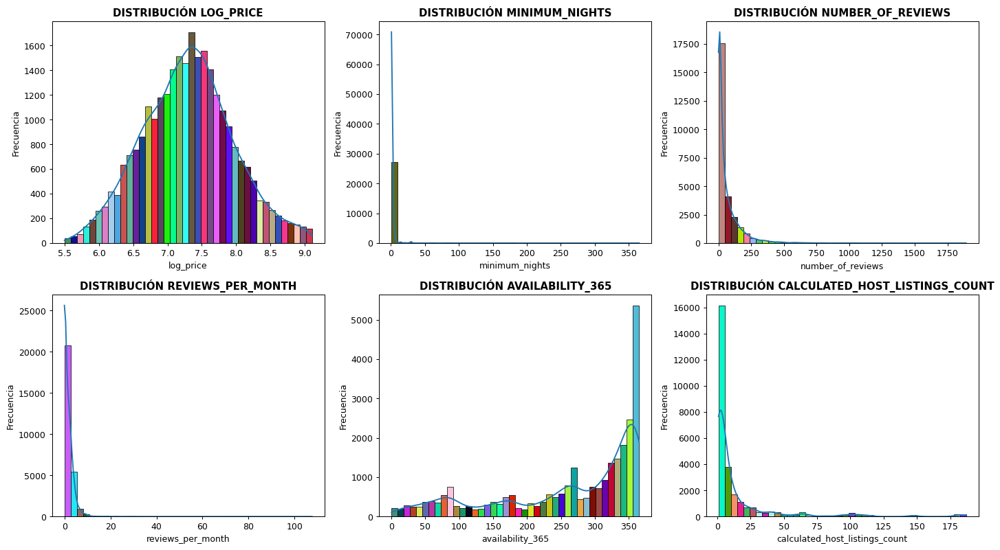
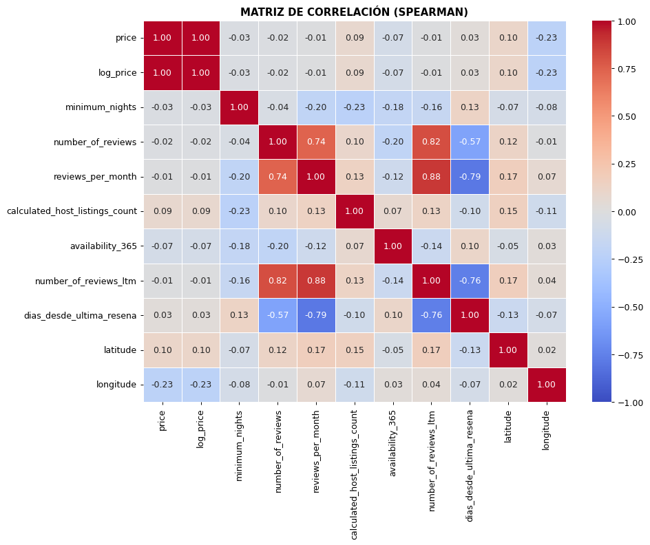
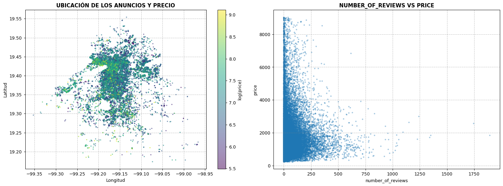
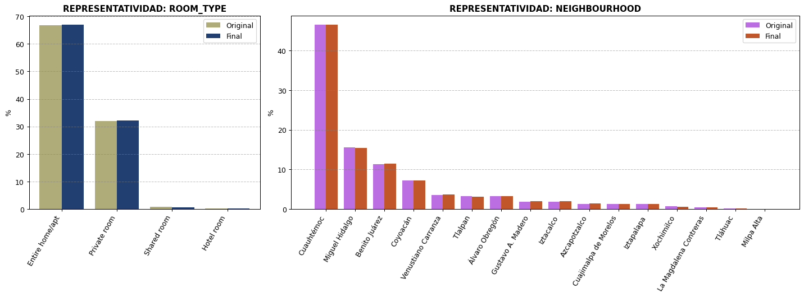

# Reporte del Reto – Análisis del mercado de Airbnb en la Ciudad de México

**Materia:** IN1002B – Desarrollo de Proyectos de Análisis de Datos
**Base de datos:** `listings.csv` (Inside Airbnb – Ciudad de México)
**Archivos de soporte:** `Listings_Preparacion_BD.ipynb`, `listings_limpio.csv`, `listings_final_codificado.csv`, carpeta `figuras_cap2/`

---

## Capítulo 1. [Insertar aquí el Capítulo 1 validado por el profesor]

> **Nota:** pega aquí el Capítulo 1 tal como lo validó el profesor del reto (planteamiento del problema, objetivos, preguntas de investigación, hipótesis y descripción de la base de datos). El Capítulo 2 supone como objetivo general **identificar los factores que influyen en el precio por noche de los alojamientos de Airbnb en la CDMX**; si el Capítulo 1 plantea otro objetivo o hipótesis, ajusta la sección 2.5 para que coincida.

---

## Capítulo 2. Preparación de la Base de Datos

### 2.1 Descripción de la base de datos original

La base `listings.csv` contiene **30,468 anuncios** y **19 variables**:

| Grupo | Variables |
| :-- | :-- |
| Identificación | `id`, `host_id`, `host_profile_id` |
| Texto libre | `name`, `host_name` |
| Ubicación | `neighbourhood_group`, `neighbourhood` (16 alcaldías), `latitude`, `longitude` |
| Alojamiento y precio | `room_type` (4 tipos), `price` (MXN por noche), `license` |
| Condiciones de reserva | `minimum_nights`, `availability_365` |
| Actividad y reseñas | `number_of_reviews`, `last_review`, `reviews_per_month`, `number_of_reviews_ltm`, `calculated_host_listings_count` |

En la exploración inicial se encontraron estos problemas: dos columnas totalmente vacías (`neighbourhood_group`, `license`), nulos en `price` (2,108; 6.92%), nulos en `last_review` y `reviews_per_month` (4,083; 13.40%), un nulo en `minimum_nights`, anuncios duplicados y precios extremos (máximo de \$1,826,199 por noche, con asimetría de 96.9).

### 2.2 Descripción de la metodología utilizada

La preparación se hizo en Python (pandas, numpy, matplotlib, seaborn y scipy), siguiendo la estructura de trabajo de la clase (**Leer archivo → Preprocesar → Análisis y visualización**) y agregando las etapas de **validación** y **exportación**. La metodología tiene siete pasos en secuencia; en cada uno se usa estadística descriptiva y gráficas para justificar y comprobar las decisiones:

| Paso | Herramientas estadísticas / gráficas |
| :-- | :-- |
| 1. Relevancia de variables | Diccionario de datos: tipo, % de nulos y número de valores únicos |
| 2. Datos perdidos | Conteo y % de nulos, gráfica de barras de nulos, comparación de `describe()` antes y después (`dataSet` vs `filter_data`), tablas cruzadas con `availability_365` y `number_of_reviews` |
| 3. Inconsistencias | 13 reglas lógicas y de rango (duplicados, coordenadas, fechas, relaciones entre columnas, texto) |
| 4. Variables numéricas | Media, mediana, cuartiles, RIC, asimetría, histogramas y diagramas de caja de `price` y `log(price)` |
| 5. Variables categóricas | Frecuencias absolutas y relativas, diagramas de barras, precio mediano por categoría (`pivot_table`) |
| 6. Transformación | Logaritmo, conversión de fecha a días, discretización y *one-hot encoding* |
| 7. Validación | Reglas de completitud y consistencia, comparación de proporciones antes y después (representatividad) y comparación de `describe()` |

### 2.3 Descripción de los pasos y criterios de decisión

#### Paso 1 – Relevancia de variables
| Variable | Decisión | Criterio |
| :-- | :-- | :-- |
| `neighbourhood_group`, `license` | Eliminar | 100% nulos: no contienen información |
| `host_profile_id` | Eliminar | Identificador técnico, redundante con `host_id` |
| `name`, `host_name` | Eliminar | Texto libre (29,037 y 4,883 valores únicos) sin valor estadístico; `host_name` además es un dato personal |
| `id`, `host_id` | Conservar solo como llave | Sirven para identificar registros, no para analizar |
| Resto (13 variables) | Conservar | Pueden explicar el precio o describir el mercado |

#### Paso 2 – Datos perdidos
- **Criterio general:** primero se separan los **nulos estructurales** (el valor falta porque no existe; se imputan con su valor lógico) de los **nulos en la variable objetivo** (se eliminan, porque imputarlos crearía datos ficticios).
- **`price` (2,108 nulos):** el 74.5% de estos anuncios tiene `availability_365 = 0`, contra solo el 0.01% de los anuncios con precio. Es decir, son **anuncios inactivos**. Se **eliminaron**. Al comparar `describe()` antes y después, las medianas y cuartiles de las demás variables casi no cambian.
- **`last_review` y `reviews_per_month` (4,083 nulos):** en el **100%** de los casos `number_of_reviews = 0`, así que son nulos estructurales. Se imputó `reviews_per_month = 0`, se creó el indicador `tiene_resenas` y `last_review` se convirtió a fecha.
- **`minimum_nights` (1 nulo):** se imputó con la **mediana (1 noche)**, que es robusta frente a la asimetría.

#### Paso 3 – Detección y corrección de inconsistencias
Se revisaron 13 reglas: duplicados, `id` repetidos, precio ≤ 0, noches mínimas fuera de [1, 365], disponibilidad fuera de [0, 365], `number_of_reviews_ltm > number_of_reviews`, reseñas en 0 con fecha de reseña, coordenadas fuera de la CDMX, fechas posteriores al corte (25/09/2026) y espacios de más en el texto.
- La única inconsistencia real fueron **79 anuncios duplicados**: tienen exactamente los mismos atributos (anfitrión, coordenadas, precio, reseñas y fechas) pero un `id` distinto, es decir, son anuncios clonados. Se eliminaron y se conservó el primero de cada grupo.
- Se estandarizó el texto de `neighbourhood` y `room_type` con `strip()`. Se confirmó que las 16 alcaldías y los 4 tipos de alojamiento están escritos igual en toda la base. Como regla de negocio, `minimum_nights` se limitó a un máximo de 365 noches.

#### Paso 4 – Variables numéricas (valores atípicos)
- **`price`:** tiene una asimetría extrema (96.87). Si se aplica el RIC directamente, el límite superior queda en \$4,408 y se pierden 2,099 anuncios, muchos de ellos legítimos de gama alta. Por eso se aplicó el **criterio de Tukey sobre `log(price)`**, que tiene una distribución casi simétrica. Los límites resultantes son **\$241.82 – \$9,058.85 MXN por noche** y se eliminaron **698 anuncios (2.46%)**, en su mayoría con precios irreales (por ejemplo, \$1.8 millones por noche).
- **Resultado:** la asimetría del precio bajó de 96.87 a **2.09** (0.09 en `log_price`). La media pasó de \$2,341.51 a \$1,845.83 y la mediana casi no cambió (\$1,500 → \$1,490).
- **Otras variables numéricas** (`minimum_nights`, `number_of_reviews`, `reviews_per_month`, `calculated_host_listings_count`, `number_of_reviews_ltm`): también tienen colas largas, pero sus valores extremos son **reales**: estancias mensuales, anuncios muy populares y anfitriones profesionales. **Se conservaron**, y se recomienda analizarlas con estadísticos robustos. `availability_365` no presenta atípicos.

#### Paso 5 – Variables categóricas
- Se verificó que las categorías sean consistentes y que todas tengan registros suficientes. Las categorías minoritarias (`Shared room`, 0.73%; `Hotel room`, 0.22%; Milpa Alta, 24 anuncios; Tláhuac, 42) **se conservaron** porque representan segmentos reales. Sus resultados deben interpretarse con cautela.

#### Paso 6 – Transformación de datos (codificación)
| Transformación | Variable nueva | Criterio |
| :-- | :-- | :-- |
| Logaritmo natural | `log_price` | Corrige la asimetría del precio |
| Fecha → días hasta la fecha de corte | `dias_desde_ultima_resena` | Convierte una fecha en una medida numérica de actividad reciente. A los anuncios sin reseñas se les asigna el máximo observado (4,250 días) y se identifican con `tiene_resenas = 0` |
| Indicador binario | `tiene_resenas` | Conserva la información de los nulos estructurales |
| Discretización de `minimum_nights` | `tipo_estancia` | Corta (1–7): 26,999; Media (8–29): 374; Larga (30+): 210 |
| *One-hot encoding* | `room_*`, `alc_*`, `estancia_*` | Las variables nominales se codifican como 0/1 para no imponer un orden que no existe |

### 2.4 Interpretación de los análisis exploratorios gráficos

**Datos perdidos y tratamiento del precio**

- Los nulos se concentran en `last_review` y `reviews_per_month` (13.40%) y en `price` (6.92%). El resto de las variables está completo.
- El histograma original de `price` es casi una sola barra pegada al cero por los valores extremos. En escala logarítmica la distribución tiene forma de campana, lo que justifica detectar los atípicos sobre `log(price)`. Después del tratamiento, el diagrama de caja del precio ya permite ver la distribución real del mercado.

**Variables categóricas y precio**

- **`room_type`:** predominan los alojamientos completos (66.94%), seguidos de las habitaciones privadas (32.11%). El precio mediano de un alojamiento completo (\$1,800) es **2.1 veces** el de una habitación privada (\$849) y 4 veces el de una compartida (\$445.5). Las habitaciones de hotel tienen una mediana parecida a la de los alojamientos completos (\$1,724), pero mucha más dispersión.
- **`neighbourhood`:** la oferta está muy concentrada. Cuauhtémoc tiene el 46.48% de los anuncios, y junto con Miguel Hidalgo (15.50%) y Benito Juárez (11.48%) suma el **73.46%**. Los precios medianos más altos están en Miguel Hidalgo (\$1,850), Cuajimalpa (\$1,789) y Cuauhtémoc (\$1,673); los más bajos, en Iztapalapa (\$827), Milpa Alta (\$814) y Tláhuac (\$679.5).

**Distribuciones, correlaciones y ubicación**

- `log_price` tiene una distribución aproximadamente normal. Las variables de reseñas, de noches mínimas y el número de anuncios por anfitrión tienen asimetría positiva fuerte. `availability_365` se concentra en valores altos (mediana de 306 días).
- En la matriz de Spearman ninguna variable numérica está fuertemente correlacionada con el precio. Las de mayor magnitud son de **ubicación**: `longitude` (ρ = −0.23, es decir, los anuncios del poniente son más caros) y `latitude` (ρ = 0.10). Las variables de reseñas tienen correlaciones casi nulas con el precio (|ρ| < 0.02), pero están muy correlacionadas entre sí, lo que generaría **multicolinealidad** si se usan juntas en un modelo.
- El mapa muestra que los anuncios se concentran en el corredor centro-poniente (Centro, Roma, Condesa y Polanco), donde predominan los precios altos. El diagrama de dispersión entre reseñas y precio no muestra una relación creciente: los anuncios con más reseñas tienden a tener precios moderados.

**Representatividad de la base final**

- Las proporciones de cada tipo de alojamiento y de cada alcaldía en la base final son prácticamente iguales a las de la base original (diferencia máxima de **0.17 puntos porcentuales**).

### 2.5 Resultados y conclusiones

**Resultados del proceso de preparación**

| Etapa | Registros eliminados | Registros restantes |
| :-- | :-: | :-: |
| Base original | – | 30,468 |
| Anuncios sin precio (inactivos) | 2,108 | 28,360 |
| Anuncios duplicados | 79 | 28,281 |
| Precios atípicos (RIC sobre `log(price)`) | 698 | **27,583** |

- **Base final limpia (`listings_limpio.csv`):** 27,583 registros × 18 columnas, el **90.53%** de la base original.
- **Base final codificada (`listings_final_codificado.csv`):** 27,583 registros × 37 columnas, 100% numéricas y sin nulos, lista para el análisis estadístico y el modelado.
- **Validación:** se cumplen las 13 reglas de completitud y consistencia. El único vacío que queda es `last_review` en los anuncios sin reseñas; es estructural y está representado por `tiene_resenas` y `dias_desde_ultima_resena`.

**Conclusiones**

1. La base original tenía columnas vacías, nulos en la variable objetivo, anuncios clonados y precios irreales que distorsionaban la estadística descriptiva (la media del precio estaba inflada y la asimetría era de 96.9). La metodología aplicada corrigió estos problemas con criterios explícitos y verificables.
2. La base final es **completa** (sin nulos no estructurales), **consistente** (rangos y reglas lógicas válidos), **representativa** (conserva la estructura del mercado con diferencias de ≤ 0.17 pp) y **relevante** (incluye las variables con potencial explicativo y otras derivadas).
3. El análisis exploratorio indica que el **tipo de alojamiento** y la **ubicación** son las variables más relacionadas con el precio. Las variables de actividad (reseñas, disponibilidad y noches mínimas) tienen relaciones débiles, lo que apoya la hipótesis de trabajo.
4. Recomendaciones para el siguiente capítulo: usar `log_price` como variable de respuesta, usar estadísticos robustos (mediana, RIC), no incluir a la vez varias variables de reseñas y considerar el tamaño de muestra reducido de las categorías minoritarias.
